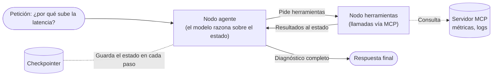
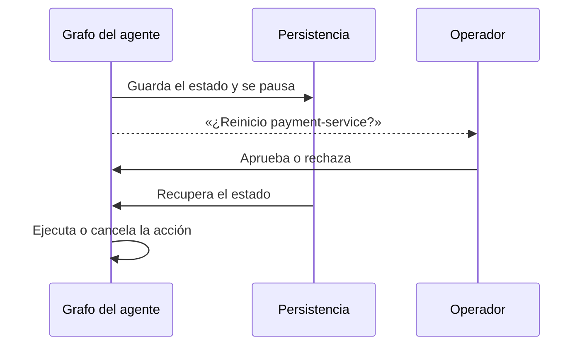

> **Revisado el 6 de noviembre de 2026**: el código se sustituye por diagramas para que el artículo no dependa de una versión concreta de las librerías, y se actualiza la gobernanza de MCP.

En la primera ola de IA generativa, la mayoría de proyectos en empresas se quedaron en el modelo conversacional: una interfaz de chat, una cadena lineal y una base de datos vectorial para hacer RAG (*Retrieval-Augmented Generation*).

Ese patrón funciona bien para soporte y consulta documental. Se queda corto cuando el objetivo es **automatizar trabajo operativo**.

En operaciones no basta con responder preguntas sobre documentación. Hay que **diagnosticar incidencias, consultar telemetría, correlacionar eventos, proponer acciones y ejecutarlas con supervisión**. Para eso conviene pasar del modelo *«pregunta → respuesta»* a agentes gobernados por **grafos de estado**, con las herramientas expuestas mediante un protocolo común como el **Model Context Protocol (MCP)**.

---

## 1. El límite de las cadenas lineales

En un flujo lineal, la ejecución va siempre en una dirección:

$$Input \longrightarrow Prompt \longrightarrow LLM \longrightarrow Output$$

En operaciones e ingeniería de datos, la realidad es otra:
- Una consulta a la base de datos puede fallar por un timeout o por una sintaxis incorrecta.
- Una métrica anómala obliga a hacer una segunda consulta a otra fuente antes de concluir nada.
- Antes de aplicar un cambio de configuración, la salida del modelo puede necesitar una validación intermedia o una confirmación humana (*human-in-the-loop*).

Forzar todo esto en una cadena lineal acaba en código frágil, con `try/except` anidados y bucles `while` difíciles de depurar. Ahí es donde **LangGraph** aporta estructura.

---

## 2. Orquestación con grafos de estado (LangGraph)

LangGraph no trata al agente como una caja negra que improvisa llamadas en un bucle, sino como un **grafo dirigido** cuyos nodos leen y actualizan un estado compartido.

Tres conceptos lo sostienen:

1. **Estado tipado (`State`):** un esquema común (un `TypedDict` o un modelo Pydantic) que recorre todos los nodos. Lo que el agente recibe o genera se acumula ahí.
2. **Nodos:** funciones que reciben el estado, hacen una operación (llamar al modelo, ejecutar una herramienta) y devuelven una actualización del estado.
3. **Aristas condicionales:** funciones que miran el estado y deciden el siguiente paso: ¿otra herramienta, aprobación humana o fin de la tarea?

Separar el estado de la ejecución da dos propiedades útiles en producción:
- **Persistencia (checkpointing):** con un *checkpointer* respaldado por una base de datos, el estado se guarda en cada paso. Si el proceso se cae o una aprobación humana tarda horas, el grafo continúa donde se quedó.
- **Límite de iteraciones:** un tope de pasos corta la ejecución si el agente entra en un bucle de herramientas que solo consume tokens.

Estas ideas no son exclusivas de LangGraph: cualquier orquestador serio de agentes acaba ofreciendo estado explícito, persistencia y límites. LangGraph es aquí el ejemplo concreto, no el requisito.

---

## 3. La pieza que faltaba: Model Context Protocol (MCP)

Conectar un agente a herramientas externas (bases de datos, logs, plataformas cloud) significaba escribir conectores a medida para cada framework. Si cambiabas de framework, rehacías la integración.

El **Model Context Protocol (MCP)** es un estándar abierto que define cómo un cliente descubre y llama a las herramientas de un servidor, con mensajes JSON-RPC. Lo creó Anthropic y desde diciembre de 2025 lo gobierna la Agentic AI Foundation, dentro de la Linux Foundation.

```
[ Agente (LangGraph) ]
         │  JSON-RPC (en local o por HTTP)
         ▼
[ Servidor MCP ] ────► [ Base de datos / Cloud / APIs / Kubernetes ]
```

### Qué aporta MCP en ingeniería de operaciones

1. **Desacoplamiento:** el servidor MCP corre en su propio proceso o contenedor, con sus dependencias y credenciales. El agente no necesita las librerías cliente de cada sistema.
2. **Superficie acotada:** el servidor expone solo lo que decide exponer: herramientas tipadas (`tools`), recursos de lectura (`resources`) y plantillas (`prompts`). El protocolo no garantiza el mínimo privilegio por sí solo: depende de que cada servidor se diseñe así (por ejemplo, con credenciales de solo lectura).
3. **Reutilización:** el mismo servidor que consulta tu agente de LangGraph lo puede usar un desarrollador desde su IDE o un script automatizado.

---

## 4. Juntando las piezas: el ciclo del agente

Supongamos un agente de diagnóstico que evalúa por qué se ha degradado un servicio ficticio, `payment-service`. El grafo tiene dos nodos y un ciclo entre ellos:



El agente consulta una métrica en el servidor MCP, interpreta el resultado, decide si necesita cruzarla con otra fuente y solo responde cuando tiene el diagnóstico completo. La arista condicional que sale del nodo agente decide en cada vuelta si hay que llamar a otra herramienta o si ya se puede responder; el límite de iteraciones pone techo a ese ciclo.

Los frameworks suelen traer piezas listas para este patrón (un nodo de herramientas y la condición que decide si seguir), así que el código propio se reduce a definir el estado, el modelo y las herramientas. Los nombres de funciones cambian entre versiones; el patrón no. Para el código al día, la [documentación oficial de LangGraph](https://docs.langchain.com/oss/python/langgraph/overview).

---

## 5. Lecciones para producción

Hacer una demo de un agente es sencillo. Que funcione de forma fiable en sistemas reales pide más disciplina:

### A. Acciones que cambian el estado
Las herramientas de lectura (consultas, inspección de pods, lectura de logs) pueden ejecutarse con relativa libertad. Las que cambian algo (reiniciar un contenedor, tocar una regla de firewall) **deben pedir confirmación humana explícita**.

La forma robusta es una **puerta de aprobación dentro del grafo**: el nodo que va a actuar pausa la ejecución, el estado queda guardado y el grafo se reanuda (o se cancela) cuando la persona responde, aunque pasen horas.



La pausa vive en la arquitectura, no en el prompt: el modelo no puede «decidir» saltársela. En LangGraph, por ejemplo, esta pieza se llama `interrupt()`.

### B. Contexto y coste de tokens
Un agente que encadena seis llamadas a herramientas acumula miles de tokens de historial. En producción conviene **resumir la memoria entre pasos** o recortar las respuestas JSON largas de las APIs antes de devolverlas al modelo.

### C. Observabilidad del razonamiento
Monitorizar un agente no es contar llamadas HTTP. Conviene registrar:
- Cuántos pasos necesitó para resolver la petición.
- Qué herramientas llamó y con qué argumentos.
- Cuántos tokens consumió en cada fase (razonamiento frente a ejecución).
- Qué parte de las tareas resolvió al primer intento y cuántas necesitaron reintentos.

---

## Conclusión

El valor de la IA en ingeniería de sistemas no está en generar texto convincente, sino en **coordinar herramientas de forma fiable**.

Con **LangGraph** para gobernar el flujo mediante grafos de estado y **MCP** para estandarizar el acceso a las plataformas, los agentes pasan a ser piezas de ingeniería más predecibles y auditables, con la persona al mando en las decisiones que importan.

---

## Para seguir leyendo

Este artículo es la entrada a una serie sobre agentes en producción. Para profundizar en una pieza concreta:

- [Portabilidad multi-agente](): cómo usar MCP y otras piezas para no atarte a un modelo ni a una herramienta.
