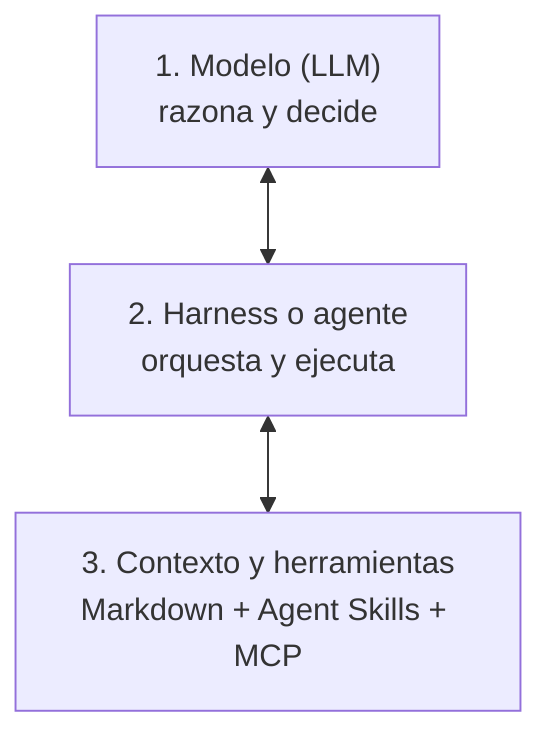

El desarrollo asistido por IA ha pasado de autocompletar líneas a agentes que trabajan en la terminal: leen repositorios, ejecutan comandos y llaman a APIs.

Con ese salto vuelve un riesgo clásico de la ingeniería de software: **la dependencia de un proveedor** (*vendor lock-in*). Muchos flujos de trabajo acaban atados a un plugin cerrado, a un formato propietario de instrucciones o a una CLI que solo funciona con un proveedor. Si ese servicio cambia sus precios, empeora su modelo o tu empresa lo bloquea, tu forma de trabajar se para.

Para evitarlo basta con un principio básico de arquitectura: separar el sistema en tres capas independientes.

---

## Las tres capas



1. **El modelo:** procesa el contexto, razona y decide qué herramienta usar. Es intercambiable: puedes usar un modelo de frontera para una refactorización compleja y uno local o más ligero para revisiones rutinarias.
2. **El harness:** la CLI, la extensión del IDE o la aplicación que gestiona el bucle de interacción, los permisos y las herramientas del sistema.
3. **El contexto y las herramientas:** tu base de conocimiento, tus reglas de trabajo y las conexiones a tus sistemas. Esta capa conviene construirla solo sobre estándares abiertos.

Si la capa 3 es independiente, cambiar de harness o de modelo deja de ser una migración y pasa a ser, sobre todo, un cambio de configuración.

---

## 1. El conocimiento, en Markdown plano

Las memorias propias de cada asistente suelen ser cajas negras difíciles de exportar. Si tus notas de arquitectura, bitácoras de incidencias y reglas de trabajo viven dentro de un agente, quedan atadas a él.

El formato más duradero sigue siendo **Markdown plano** en tu propio sistema de archivos:
- **Control:** se versiona con Git y se sincroniza como cualquier otro fichero.
- **Independencia:** cualquier agente puede leerlo y editarlo con sus herramientas básicas de lectura y búsqueda.
- **Durabilidad:** si cambias de agente, tus decisiones documentadas siguen ahí.

---

## 2. Herramientas comunes con MCP (Model Context Protocol)

Conectar un agente a una base de datos o a servicios externos (repositorios, gestor de incidencias, correo) exigía escribir una integración a medida para cada asistente.

Con el **Model Context Protocol (MCP)**, cada herramienta se publica como un servidor independiente y el agente la consume con mensajes JSON-RPC, en local o por HTTP.

En la práctica, el mismo servidor MCP para tu gestor de incidencias funciona igual en cualquier agente compatible. Cada herramienta lo registra en su propio fichero de configuración, pero el servidor no se toca: la integración se escribe una sola vez.

---

## 3. Procedimientos compartidos con Agent Skills

Para que varios agentes sigan los mismos procedimientos (revisar un despliegue, procesar métricas o validar configuraciones), las instrucciones tienen que vivir en un único sitio.

**Agent Skills** es un formato abierto pensado para eso: cada habilidad es una carpeta con un fichero `SKILL.md` que lleva, como mínimo, un nombre y una descripción, seguidos de las instrucciones. El agente solo carga el nombre y la descripción al arrancar y lee el resto cuando la tarea lo pide.

```yaml
---
name: revisar-despliegue
description: Comprueba el estado de los servicios tras un despliegue y resume los errores. Solo lectura.
---
```

Si mantienes las habilidades en una única carpeta versionada que leen todos tus agentes, una mejora en un procedimiento llega a todos a la vez.

---

## 4. Seguridad y secretos: una mejora continua

Un problema habitual al combinar herramientas de IA es la dispersión de credenciales: tokens en texto plano en ficheros de configuración, secretos duplicados o permisos amplios concedidos «por si acaso».

La seguridad en sistemas agénticos no es algo que se marca una vez como hecho; **siempre hay margen para endurecerla poco a poco**:

1. **Higiene básica:** ningún secreto en texto plano en la configuración de los agentes.
2. **Variables de entorno:** las credenciales viven en el entorno del sistema y los agentes las leen por interpolación (`${VARIABLE}`). Un pequeño script de arranque puede comprobar que existen al preparar una máquina nueva.
3. **Gestores de secretos:** en entornos más maduros, las herramientas leen las credenciales de un gestor dedicado en lugar del perfil del usuario.
4. **Aislamiento:** limitar qué puede tocar el agente en tu máquina con las herramientas de aislamiento del sistema (en Linux, por ejemplo, `bubblewrap`) y dar permisos de solo lectura por defecto a los servidores MCP que tocan producción.

Asumir que la seguridad es iterativa evita la parálisis y te permite subir la protección a medida que delegas tareas más delicadas.

---

## Conclusión

Tu ventaja técnica no está en la CLI que uses esta semana, sino en la calidad de tu contexto y en lo modulares que sean tus herramientas.

Construir sobre Markdown, MCP y formatos abiertos como Agent Skills te permite cambiar de modelo o de herramienta cuando aparezca algo mejor, sin tirar el trabajo hecho.

---

## Para seguir leyendo

- [De chatbots a agentes](): cómo se organiza un agente con grafos de estado y herramientas MCP.
