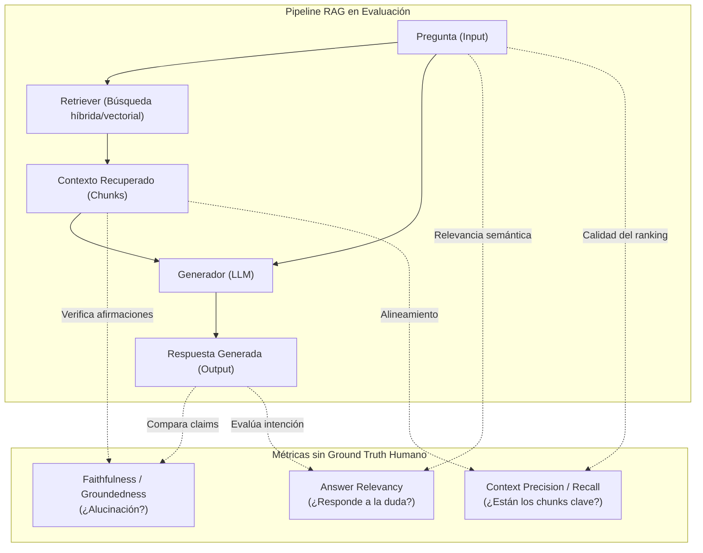

El mayor cuello de botella al llevar un sistema de **Generación Aumentada por Recuperación (RAG)** a producción rara vez está en la base de datos vectorial o en la latencia del modelo: está en **la evaluación**.

Cuando cambias la estrategia de fragmentación (*chunking*), sustituyes el modelo de *embeddings*, ajustas el *top-k* o actualizas el prompt del sistema, necesitas saber de inmediato: *¿he mejorado la precisión o he introducido una regresión silenciosa?*

El enfoque tradicional consiste en recurrir a expertos del dominio para que redacten manualmente cientos de preguntas con sus correspondientes respuestas canónicas (*ground truth*). En entornos corporativos reales, este proceso tarda semanas, bloquea los despliegues y queda desactualizado en cuanto la documentación de origen cambia.

Para iterar con la agilidad que exige la ingeniería de software moderna, la solución pasa por desacoplar la validación continua del esfuerzo humano mediante **test sets sintéticos** y **métricas de consistencia interna**.

---

## 1. El dilema de la validación manual frente a CI/CD

Validar un RAG manualmente no escala. Si tienes miles de páginas de procedimientos técnicos, manuales o wikis en constante cambio, depender de un lote estático de preguntas humanas plantea tres problemas críticos:

1. **Sesgo de cobertura:** Los humanos tendemos a preguntar sobre lo que recordamos o sobre casos extremos que nos han dado problemas recientes, dejando desatendidas amplias zonas de la base documental.
2. **Coste temporal:** Cada cambio arquitectónico en el pipeline de datos requiere re-validar manualmente para garantizar que no se han roto respuestas previas.
3. **Fragilidad de la respuesta de referencia:** En lenguaje natural, una respuesta correcta puede formularse de infinitas formas. Evaluar mediante similitud léxica (BLEU, ROUGE) o distancia semántica contra un texto humano fijo castiga respuestas válidas que usaron sinónimos o una estructura diferente.

La respuesta arquitectónica es invertir la dinámica: **usar la propia IA para interrogar a la base de conocimiento y medir su fidelidad sin requerir respuestas humanas predefinidas.**

---

## 2. Métricas de evaluación sin Ground Truth Humano

¿Cómo podemos evaluar si una respuesta es buena si no tenemos la «solución oficial» para contrastarla? La clave radica en descomponer la evaluación en **dos vectores ortogonales**: la calidad de la recuperación (*Retrieval*) y la fidelidad de la generación (*Generation*).



### A. Fidelidad / Fundamentación (*Faithfulness* o *Groundedness*)
Mide si cada una de las afirmaciones (*claims*) presentes en la respuesta generada puede inferirse de forma estricta a partir del contexto recuperado.
- Si el modelo afirma algo que no aparece en los chunks entregados, la puntuación cae.
- **Qué detecta:** Alucinaciones del modelo y fuga de conocimiento paramétrico previo no respaldado por la documentación corporativa.

### B. Relevancia de la respuesta (*Answer Relevancy*)
Mide si la respuesta generada atiende directamente a lo que el usuario preguntó, independientemente de si la información es verdadera.
- Se penalizan respuestas redundantes, evasivas o que se van por las ramas sin resolver la intención de búsqueda.

### C. Precisión de contexto (*Context Precision*)
Evalúa si los fragmentos de texto que contienen la información relevante se posicionaron en los primeros lugares de la lista de resultados entregada al LLM, minimizando el ruido en la ventana de contexto.

---

## 3. Estrategia 1: Generación sintética con RAGAS

El framework open-source **RAGAS** permite generar conjuntos de pruebas automatizados extrayendo nodos o fragmentos de la base documental indexada y sintetizando preguntas con distintos niveles de complejidad:
- **Preguntas simples:** La respuesta reside en un único chunk.
- **Preguntas de razonamiento multi-contexto (*Multi-hop*):** Exigen combinar información dispersa en dos o más documentos distintos.
- **Preguntas condicionales:** Plantean un escenario hipotético («¿Qué debo hacer si ocurre X bajo la condición Y?»).

```python
from ragas.testset.generator import TestsetGenerator
from ragas.testset.evolutions import simple, reasoning, multi_context
from langchain_community.document_loaders import DirectoryLoader
from langchain_openai import ChatOpenAI, OpenAIEmbeddings

# 1. Cargar documentos corporativos
loader = DirectoryLoader("./documentacion_tecnica", glob="**/*.md")
documents = loader.load()

# 2. Configurar generador con modelos de razonamiento y embeddings
generator_llm = ChatOpenAI(model="gpt-4o")
critic_llm = ChatOpenAI(model="gpt-4o")
embeddings = OpenAIEmbeddings()

generator = TestsetGenerator.from_langchain(
    generator_llm=generator_llm,
    critic_llm=critic_llm,
    embeddings=embeddings
)

# 3. Generar dataset sintético con distribución de complejidad
testset = generator.generate_with_langchain_docs(
    documents,
    test_size=50,
    distributions={
        simple: 0.4,
        reasoning: 0.4,
        multi_context: 0.2
    }
)

# Exportar a DataFrame para ejecutar en pipelines de CI/CD
df_eval = testset.to_pandas()
```

Una vez ejecutado el pipeline RAG sobre este test set, la evaluación de *Faithfulness* y *Answer Relevancy* se computa de forma programática:

```python
from ragas import evaluate
from ragas.metrics import faithfulness, answer_relevancy, context_precision
from datasets import Dataset

# Dataset con columnas: question, contexts, answer
dataset = Dataset.from_pandas(df_resultados_rag)

resultados = evaluate(
    dataset=dataset,
    metrics=[
        faithfulness,
        answer_relevancy,
        context_precision
    ]
)

print(resultados)
# Salida: {'faithfulness': 0.94, 'answer_relevancy': 0.89, 'context_precision': 0.86}
```

---

## 4. Estrategia 2: Azure AI Foundry Evaluation SDK

En infraestructuras empresariales basadas en Microsoft Cloud, el SDK **`azure-ai-evaluation`** proporciona evaluadores integrados preparados para pipelines de CI/CD en Azure DevOps o GitHub Actions.

Dispone de la clase `Simulator` para modelar usuarios interactuando con el sistema y evaluadores de backend como `GroundednessEvaluator` y `RelevanceEvaluator`:

```python
import os
from azure.ai.evaluation import GroundednessEvaluator, RelevanceEvaluator

# Configuración de credenciales del evaluador respaldado por Azure AI Foundry
model_config = {
    "azure_endpoint": os.environ["AZURE_OPENAI_ENDPOINT"],
    "api_key": os.environ["AZURE_OPENAI_API_KEY"],
    "azure_deployment": "gpt-4o",
    "api_version": "2024-02-15-preview"
}

groundedness_eval = GroundednessEvaluator(model_config)
relevance_eval = RelevanceEvaluator(model_config)

# Evaluación puntual de una inferencia
resultado_groundedness = groundedness_eval(
    response="Para reiniciar el servicio hdp-13 ejecute systemctl restart ipg-service.",
    context="Procedimiento de mantenimiento: el servicio ipg-service en hdp-13 se reinicia mediante systemctl restart ipg-service."
)

resultado_relevance = relevance_eval(
    query="¿Cómo reinicio el nodo hdp-13?",
    response="Para reiniciar el servicio hdp-13 ejecute systemctl restart ipg-service."
)

print(f"Groundedness: {resultado_groundedness['groundedness']} / 5")
print(f"Relevance: {resultado_relevance['relevance']} / 5")
```

---

## 5. El matiz crítico: Complemento, jamás sustituto

Es indispensable mantener una postura técnica rigurosa frente a la auto-evaluación con LLMs:

> [!IMPORTANT]
> La auto-evaluación sintética mide **consistencia interna**, no verdad ontológica.

1. **Si la fuente está desactualizada o contiene errores:** Un modelo RAG que recupere un documento erróneo y lo repita fielmente obtendrá una puntuación perfecta de `Faithfulness = 1.0` y `Groundedness = 5/5`. El sistema no sabe si el dato es verdadero en el mundo real; solo sabe que no ha alucinado respecto al contexto que se le entregó.
2. **Evaluadores como LLM-as-a-Judge:** El evaluador sintético es otro LLM y está sujeto a sus propios sesgos de posición y longitud. Para minimizar variabilidad, deben fijarse temperaturas a cero y emplear prompts estructurados con esquemas JSON rígidos.

### La pirámide de pruebas en RAG

La mejor práctica en producción consiste en combinar ambos mundos en una estructura escalonada:

```text
       ▲
      / \
     /   \     Validación Humana Experta (Golden Dataset)
    /     \    50-100 preguntas críticas curadas por especialistas de negocio.
   /───────\   Se ejecutan antes de despliegues mayores a producción.
  /         \
 /           \   Auto-evaluación Sintética Continua (RAGAS / Foundry)
/             \  Cientos de preguntas generadas automáticamente en cada PR/commit.
/───────────────\ Detección inmediata de regresiones de ranking y alucinación en CI/CD.
```

---

## Conclusión y Próximos Pasos

Esperar a disponer de un conjunto masivo de preguntas humanas para empezar a medir un RAG es una receta segura para la parálisis del proyecto. 

Implementar **generación sintética y métricas de fidelidad sin ground truth** permite establecer una línea base de observabilidad en cuestión de horas. Nos da la seguridad necesaria para refactorizar estrategias de indexación, probar nuevos modelos de embeddings y optimizar hiperparámetros con la tranquilidad de que cualquier degradación será detectada inmediatamente en nuestro pipeline de integración continua.
