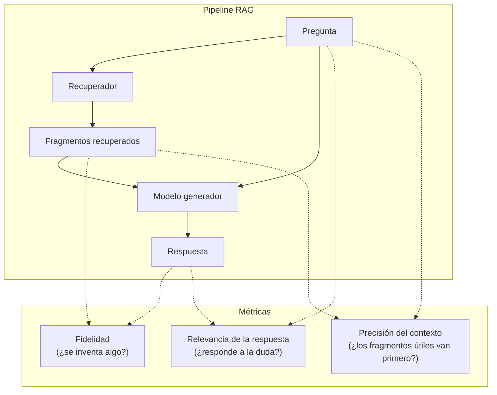
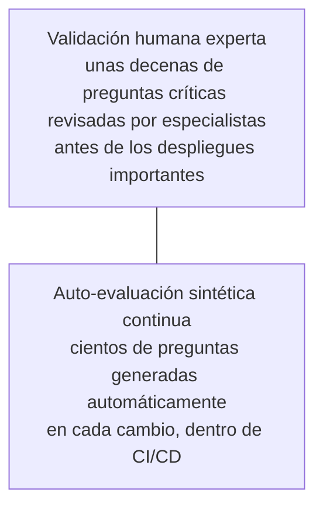

Al llevar un sistema de **generación aumentada por recuperación (RAG)** a producción, el cuello de botella rara vez está en la base de datos vectorial o en la latencia del modelo: está en **la evaluación**.

Cuando cambias la forma de trocear los documentos (*chunking*), el modelo de *embeddings*, el número de fragmentos recuperados (*top-k*) o el prompt del sistema, necesitas saber pronto si has mejorado o si has introducido una regresión silenciosa.

Lo habitual es pedir a expertos del dominio que redacten a mano cientos de preguntas con su respuesta de referencia (*ground truth*). En una empresa, eso tarda semanas, frena los despliegues y se queda desactualizado en cuanto cambia la documentación.

Para iterar más rápido, conviene separar la validación continua del esfuerzo humano con **test sets sintéticos** y **métricas que no dependen de respuestas escritas por personas**.

---

## 1. Por qué la validación manual no encaja con CI/CD

Si tienes miles de páginas de procedimientos, manuales o wikis que cambian a menudo, depender de un lote fijo de preguntas humanas tiene tres problemas:

1. **Cobertura sesgada:** las personas preguntamos sobre lo que recordamos o sobre los casos que nos dieron problemas hace poco. Grandes zonas de la documentación se quedan sin probar.
2. **Coste en tiempo:** cada cambio en el pipeline obliga a revalidar a mano que no se ha roto nada.
3. **Referencias frágiles:** una respuesta correcta se puede formular de muchas maneras. Comparar con un texto humano fijo, por coincidencia de palabras (BLEU, ROUGE) o por distancia semántica, penaliza respuestas válidas redactadas de otra forma.

La alternativa es darle la vuelta: **usar la propia IA para generar preguntas a partir de la documentación y medir la fidelidad de las respuestas sin necesitar respuestas humanas.**

---

## 2. Qué se puede medir sin respuestas humanas

La evaluación se separa en dos partes: la calidad de la **recuperación** (¿llegan los fragmentos adecuados?) y la de la **generación** (¿la respuesta se ciñe a ellos y responde a la pregunta?).

### A. Fidelidad (*faithfulness* o *groundedness*)
Mide si cada afirmación de la respuesta se puede deducir de los fragmentos recuperados.
- Si el modelo afirma algo que no está en ellos, la puntuación baja.
- **Qué detecta:** invenciones del modelo y conocimiento propio del modelo que la documentación no respalda.

### B. Relevancia de la respuesta (*answer relevancy*)
Mide si la respuesta atiende a lo que se preguntó, sea o no verdadera. Penaliza respuestas redundantes, evasivas o que se van por las ramas.

### C. Precisión del contexto (*context precision*)
Mide si los fragmentos con la información útil aparecen en los primeros puestos de lo que recibe el modelo, para que haya menos ruido en su contexto.

Otras métricas, como la **exhaustividad del contexto** (*context recall*), sí necesitan una respuesta de referencia. Aquí ayudan los test sets sintéticos: la referencia la genera el propio proceso a partir de la documentación, no una persona.

---

## 3. Cómo se genera un test set sintético

Las herramientas de evaluación de RAG, tanto las de código abierto como RAGAS como los evaluadores gestionados de las plataformas cloud (por ejemplo, los de Microsoft Foundry), siguen el mismo patrón:

1. **Toman fragmentos de la documentación indexada.**
2. **Un modelo redacta preguntas** a partir de ellos, con distintos niveles de dificultad:
   - **Simples:** la respuesta está en un solo fragmento.
   - **De varios saltos (*multi-hop*):** hay que combinar información de dos o más documentos.
   - **Condicionales:** plantean un escenario («¿qué hago si ocurre X con la condición Y?»).
3. **Otro modelo, o el mismo con otro prompt, revisa** que cada pregunta tenga sentido y se pueda responder con la documentación, y descarta las que no.
4. **Se guarda el conjunto** (pregunta, fragmentos de origen y respuesta de referencia sintética) y se reutiliza en cada ejecución.

Después, en cada cambio, el pipeline RAG responde a esas preguntas y un modelo evaluador puntúa la fidelidad, la relevancia y la precisión del contexto. Si alguna baja respecto a la ejecución anterior, la integración continua lo marca antes de desplegar.

Los nombres de clases y funciones cambian con cada versión de estas librerías; el patrón no. Para el código al día, la documentación de [RAGAS](https://docs.ragas.io/) o la de [evaluadores de Microsoft Foundry](https://learn.microsoft.com/azure/foundry/concepts/built-in-evaluators).

---

## 4. El matiz importante: complemento, nunca sustituto

> **La auto-evaluación sintética mide consistencia interna, no si la respuesta es verdad en el mundo real.**

1. **Si la fuente está desactualizada o tiene errores**, un RAG que recupere ese documento y lo repita fielmente obtendrá la máxima fidelidad. El sistema no sabe si el dato es cierto; solo sabe que no se lo ha inventado respecto a lo que recibió.
2. **El evaluador también es un modelo**, con sus propios sesgos (por ejemplo, de posición o de longitud). Para reducir la variabilidad conviene fijar la temperatura a cero y pedirle una salida estructurada.

### Pruebas en dos niveles

En producción funciona bien combinar las dos cosas:

---

## Conclusión

Esperar a tener un gran conjunto de preguntas humanas para empezar a medir un RAG suele acabar en un proyecto parado.

Con **preguntas sintéticas y métricas de fidelidad** puedes tener una primera línea base enseguida. Así puedes cambiar la indexación, probar otros modelos de embeddings o ajustar parámetros sabiendo que, si algo empeora, la integración continua lo detectará antes de llegar a producción.

---

## Para seguir leyendo

- [De chatbots a agentes](): cómo se organiza un agente con grafos de estado y herramientas MCP.
