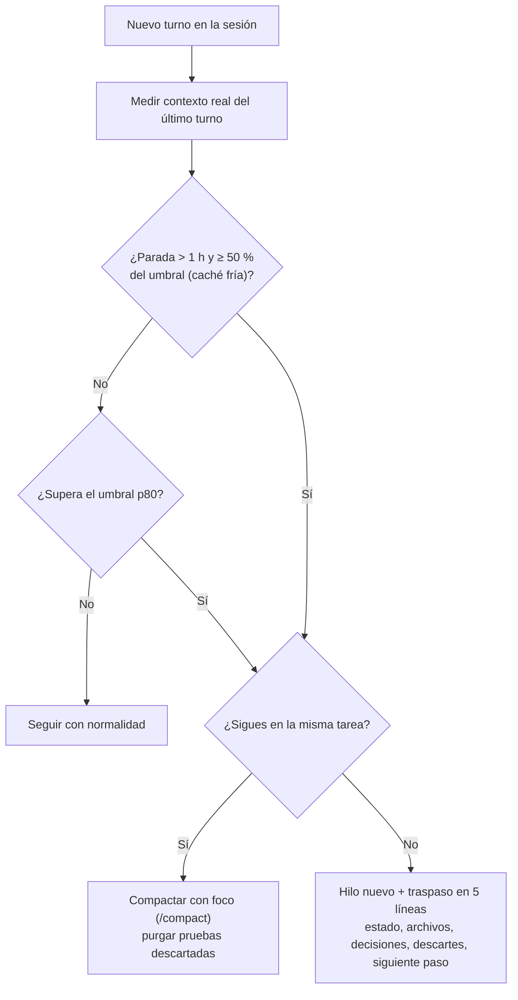

Si usas el mismo chat todo el día con un asistente de IA (Claude, ChatGPT, Gemini u otros), acabas consumiendo más del doble de cuota mientras tu pregunta nueva representa apenas el 1 % de lo que el modelo lee.

Un modelo de lenguaje no «recuerda» lo anterior como una persona: **en cada turno vuelve a procesar la conversación entera desde el principio**. Eso incluye instrucciones de sistema, esquemas de herramientas conectadas, archivos leídos hace horas, trazas de error que ya resolviste y pruebas descartadas.

Cuando encadenas cuatro tareas distintas en el mismo hilo, ese arrastre pasa con facilidad de **1,9 M a 4,8 M de tokens** para resolver exactamente el mismo trabajo. Además de disparar el gasto, ese historial viejo introduce ruido, degrada la atención sobre lo que queda en medio (*lost in the middle*) y vuelve más lenta cada respuesta.

---

## El flujo de decisión: cuándo compactar y cuándo cortar

La solución no consiste en empezar de cero cada dos minutos, sino en aplicar tres reglas claras según el estado de la sesión:



1. **Misma tarea → compacta con foco:** resume el hilo para eliminar salidas largas de terminal, intentos fallidos y archivos que ya no necesitas, manteniendo solo las decisiones y el estado actual.
2. **Cambio de tarea → corta y abre un hilo nuevo:** cierra el contexto anterior y arranca limpio con un traspaso breve de cinco líneas:
   - qué se ha resuelto;
   - qué archivos se tocaron;
   - qué decisiones quedan cerradas;
   - qué se descartó (para no repetirlo);
   - cuál es el siguiente paso concreto.
3. **Sesión fría (lleva horas o días cerrada) → inicia de nuevo:** aunque resulte tentador «seguir donde lo dejaste ayer», retomar un chat antiguo con mucho historial suele salir más caro y dar peor contexto que abrir uno limpio.

Si además guardas el estado real del trabajo en ficheros Markdown versionados del proyecto (notas de tarea y bitácora) en lugar de depender del historial del chat, abrir una sesión nueva cuesta segundos.

---

## El coste oculto de retomar una sesión que llevaba tiempo cerrada

Uno de los hábitos más frecuentes —y más caros— es reabrir al día siguiente (o varias horas después) una conversación larga para «no perder el contexto». En realidad ocurre lo contrario por dos motivos:

- **La caché de prompt caduca:** mientras encadenas mensajes de forma continua, el proveedor reutiliza el prefijo en caché y el coste de releer el historial se reduce drásticamente. Cuando la sesión lleva tiempo parada, esa caché expira: el primer mensaje que envías al volver paga de golpe la reescritura completa de todo el historial acumulado, sin descuento.
- **El estado real ya cambió:** entre una sesión y la siguiente es habitual haber editado archivos, cerrado tareas o tomado decisiones fuera de ese chat. Reenviar cientos de turnos antiguos obliga al modelo a reconciliar información desfasada.

En la práctica, retomar una sesión fría solo compensa si era corta. Si ya arrastra peso y lleva más de una hora parada, **iniciar de nuevo en un hilo limpio** —leyendo el estado actualizado desde tus notas Markdown o pegando el traspaso en cinco líneas— cuesta menos tokens y produce respuestas más precisas.

---

## La trampa de automatizar el aviso: tokens reales vs. tamaño del archivo

Cuando estás metido en un problema complejo, es fácil olvidarte de cuánto ha crecido la conversación. Por eso merece la pena montar un **aviso automático en local** (por ejemplo, un *hook* al enviar un mensaje) que te recuerde cuándo toca compactar o abrir hilo nuevo.

Al construirlo aparece una trampa habitual: **medir el tamaño en bytes del fichero de la transcripción**. Parece la vía más rápida, pero falla en cuanto compactas la sesión: el contexto activo que envía la API baja de golpe, mientras que el fichero en disco solo crece. El resultado son falsos avisos continuos justo después de haber compactado.

La métrica fiable está en el bloque `usage` del último turno del asistente:

```python
def contexto_real(usage: dict) -> int:
    return (
        int(usage.get("input_tokens", 0) or 0)
        + int(usage.get("cache_read_input_tokens", 0) or 0)
        + int(usage.get("cache_creation_input_tokens", 0) or 0)
    )
```

Sumar entrada directa, lectura de caché y escritura en caché te da el tamaño real de la ventana que el modelo acaba de procesar. En cuanto compactas, ese número cae por debajo del umbral y el aviso se rearma solo para el siguiente cruce.

---

## Calibrar el umbral con tus propios datos (y vigilar la caché fría)

Un límite fijo (por ejemplo, 100k tokens para todo el mundo) rara vez encaja: un proyecto con pocos archivos no tiene el mismo perfil que un monorepo con varias herramientas conectadas.

Tres ajustes sencillos hacen que el aviso sea útil sin convertirse en ruido:

1. **Umbral adaptativo por proyecto (percentil 80):** calcula el p80 del pico de contexto de tus sesiones anteriores en ese proyecto (con un valor por defecto de `150k` tokens hasta reunir al menos 20 sesiones). Así el aviso salta solo cuando una sesión se sale de tu patrón habitual.
2. **Escalado sin insistencia:** avisa al cruzar el umbral y vuelve a avisar solo cada `+40 %` adicional si decides continuar. Nunca bloquea una herramienta ni interrumpe a mitad de una ejecución no interactiva.
3. **Disparador de reapertura en frío:** el *hook* comprueba también la marca temporal del último turno del asistente; si han pasado más de 60 minutos y el contexto ya supera el 50 % del umbral p80, lanza el aviso antes de seguir acumulando turnos sobre una caché caducada.

---

## Qué dicen las mediciones reales

Al aplicar este aviso automático junto con otras prácticas de higiene de contexto (instrucciones compactas cargadas bajo demanda, apagar servidores MCP ociosos y consultar datos locales con SQL en lugar de volcar archivos enteros al prompt), el efecto se nota rápido en los números agregados de uso diario:

| Indicador medido | Antes | Después | Cambio |
|---|---:|---:|---:|
| Sesiones con pico ≥ 200k tokens | 29,2 % | 20,5 % | -8,7 puntos |
| Mediana del pico de contexto | 163k tokens | 111k tokens | -32 % |
| Lectura de caché por sesión (`cr/ses`) | 29,3 MTok | 9,8 MTok | -66 % |

Más del 95 % del volumen total de tokens en sesiones con agentes suele ser relectura de historial acumulado y definiciones de herramientas. Bajar el tamaño medio de ventana reduce el coste de forma estructural y, al mismo tiempo, mejora la precisión del modelo.

---

## Lo que no funcionó: prohibir lecturas grandes a ciegas

En paralelo probé otro enfoque más agresivo: un *hook* que bloqueaba lecturas de archivos por encima de 400 líneas para forzar al agente a delegar la búsqueda.

Al auditar más de 800 transcripciones reales, el resultado fue claro: cerca de 200 bloqueos, casi todos en tareas que necesitaban ver el archivo completo; en la sesión principal, la mayoría de las veces el agente simplemente rodeaba el bloqueo usando comandos de terminal o `grep` en varios pasos. Añadía fricción y turnos extra sin ahorro real, así que quedó descartado.

La lección práctica es sencilla: **dar visibilidad en el momento exacto (aviso de contexto + traspaso corto) ahorra más que poner prohibiciones rígidas**.

---

## Conclusión

Si notas que tu asistente de IA se vuelve lento, pierde detalles o consume la cuota más rápido de lo esperado, el problema rara vez es el modelo: suele ser un historial que lleva horas acumulando peso muerto.

Cortar por tarea, no retomar sesiones que llevan horas cerradas, compactar cuando el contexto real cruza tu p80 y mantener el estado fuera del chat en ficheros Markdown simples te devuelve velocidad, foco y control sobre el consumo.

---

## Para seguir leyendo

- [Portabilidad multi-agente: cómo diseñar un entorno de trabajo independiente del LLM y de la CLI](): cómo mantener tu contexto en Markdown, MCP y Agent Skills sin depender de un único proveedor.
- [De chatbots a agentes: arquitectura en producción con LangGraph y MCP](): gestión de estado explícita y herramientas desacopladas en producción.
